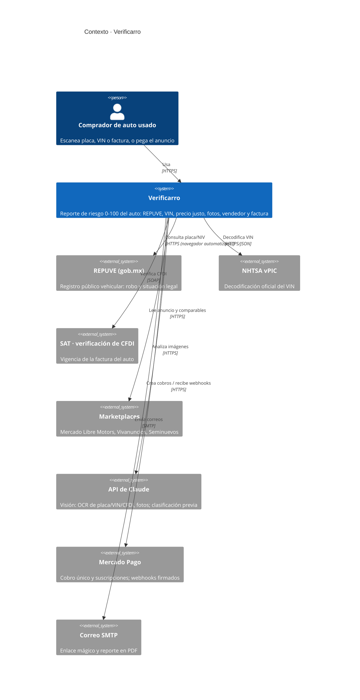
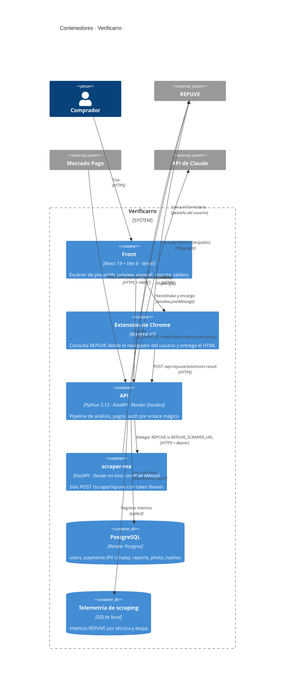
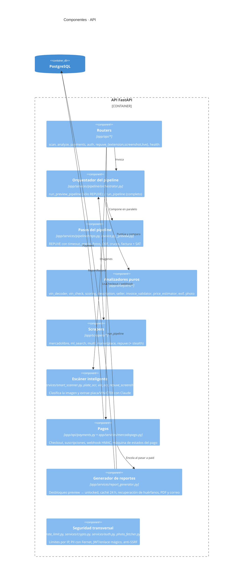
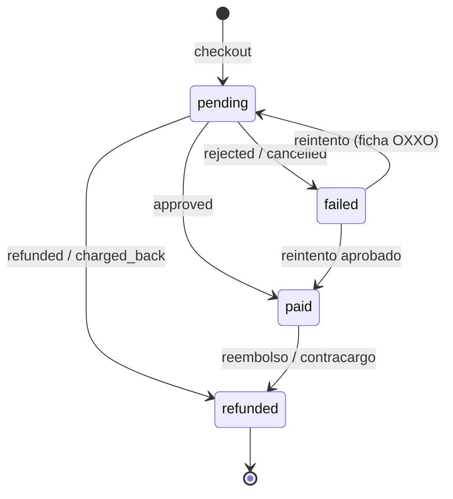

# Arquitectura · Verificarro

Modelo C4: contexto → contenedores → componentes. Los diagramas son texto (Mermaid), se versionan con el
código y nombran módulos que existen en el repo (`backend/app/...`, `frontend/src/...`, `extension/...`).

## 1. Contexto

## 2. Contenedores

## 3. Componentes de la API (`backend/app`)

## 4. Estados

Pago único (webhook `topic=payment`, `app/db/models/payment.py::PAYMENT_TRANSITIONS`). Cualquier otra
transición se ignora con 200 (`invalid-transition`) para que Mercado Pago no reintente:

Suscripción (`topic=preapproval`, `SUBSCRIPTION_TRANSITIONS`): `pending → paid (authorized) | failed
(cancelled)`, `paid → pending (paused) | failed (cancelled)`; `failed` es terminal.

Reporte (`app/db/models/report.py::ReportStatus`): `preview` (gratis, sólo REPUVE) → `unlocked` (pipeline
completo) cuando el pago está en `paid`; `unlocked` no vuelve a correr el pipeline. Ver ADR 0002.

## 5. Despliegue

| Pieza | Dónde | Cómo se publica |
|---|---|---|
| API | Render, servicio web `verificarro-api` (Docker, `backend/Dockerfile`) | `render.yaml` (Blueprint) con `autoDeploy` en cada push a la rama conectada |
| PostgreSQL | Render, `verificarro-db` | Blueprint; migraciones `alembic upgrade head` al arrancar el contenedor |
| Front | Vercel, raíz `frontend/` (`vercel.json`) | Integración Git de Vercel; también `vercel --prod` manual |
| scraper-mx | VPS con IP de México (`backend/scraper-mx.Dockerfile`) | `docker run` manual; opcional |
| Extensión | Chrome (carga sin empaquetar) | Manual; no publicada en la tienda |

Detalle operativo y reversa en [`RUNBOOK.md`](../../RUNBOOK.md).
